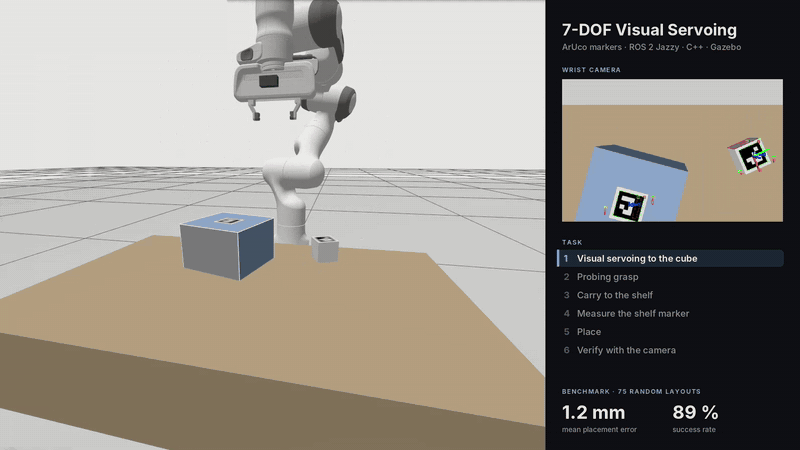
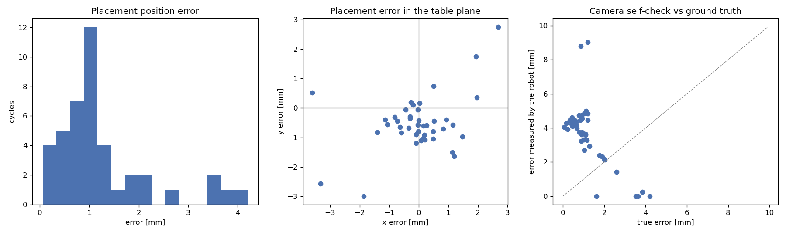
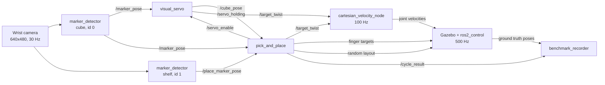

# Panda Visual Servoing (ROS 2)

[](https://github.com/moavazpour/panda-visual-servoing-ros2/actions/workflows/build.yml)

A 7-DOF Franka Panda arm in Gazebo that finds a cube with a wrist camera, servos above it,
picks it up and places it on a shelf, guided only by ArUco markers.
Every cycle starts from a new random layout, and the accuracy is benchmarked against the
simulator's ground truth.

Written from scratch in C++ on ROS 2 Jazzy and Gazebo Harmonic.



## Highlights

- **Marker pose estimation** with OpenCV ArUco: subpixel corners, `SOLVEPNP_IPPE_SQUARE`,
  and validity checks (image border, reprojection error, finite values)
- **Position-based visual servoing (PBVS)** in the robot base frame, with a low-pass filter,
  outlier rejection, a Schmitt trigger between moving and holding, and 4-fold cube symmetry
- **Cartesian velocity control** written from scratch with KDL and Eigen: damped
  least-squares inverse kinematics near singularities, a null-space task that keeps the arm
  near its home posture, and closed-loop pose feedback with anti-windup
- **Pick-and-place state machine** with contact detection, a two-step place localization
  (coarse, then close-up) and a camera check of the result
- **Probing grasp**: the fingers close slowly and stop when they feel the cube, so it is not
  pushed; the measured offset re-centres the hand before the final grip. While carrying, both
  fingers share one target, which keeps the cube centred like the gear in the real Franka Hand
- **Using the 7th joint**: every cycle picks a random elbow swivel in the null space of the
  hand task, so the arm reaches the same poses with a different posture, while a second
  null-space term keeps the elbow above the table and the shelf
- **Randomized experiments**: the cube and the shelf are moved to random poses through the
  Gazebo service API before every cycle
- **Ground-truth benchmark**: a recorder node compares the result with Gazebo's true poses
  and writes one CSV row per cycle; a script reports statistics and plots

## Results

75 consecutive cycles with random cube and shelf poses. The error is the horizontal distance
between the cube centre and the shelf centre, taken from Gazebo's ground truth.

| Metric | Value |
|---|---|
| Placement error, mean ± std | 1.2 ± 0.9 mm |
| Placement error, median / p95 / max | 1.0 / 2.7 / 5.3 mm |
| Yaw error, median / p95 | 0.5° / 0.9° |
| Robot's own error estimate vs ground truth | 0.1 mm mean difference |
| Cycle time, mean | 49 s |
| Success rate (cube standing on the shelf) | 67 / 75 (89 %) |



The right plot compares the error the robot measures with its own camera against the truth.
The robot looks at the placed cube from the same distance it measured the shelf marker from,
so the camera's depth error is the same in both measurements and cancels out. Without a
ground truth, as on a real robot, its own report can be trusted.

Of the 8 failed cycles, 5 did not see the shelf marker from the overview pose, and in 3 the
gripper closed to 78 mm, wider than the cube, and the cube did not end up on the shelf.

### How the benchmark guided the development

| Version | Change | Placement error | Success |
|---|---|---|---|
| A | `mimic` joint for the second finger | bimodal: the second finger did not follow reliably | – |
| B | independent fingers, both pushing with full force | 15.3 ± 0.5 mm | 73 % |
| C | fingers coupled in software, cube kept centred | 1.2 ± 1.0 mm | 70 % |
| D | shelf measured before the pick, layouts kept in view, verification from the shelf viewpoint | **1.2 ± 0.9 mm** | **89 %** |

The physics engine ignores `mimic` joints. With two independent fingers that both push with
their maximum force, nothing pulls the cube back to the centre, so it slid against one
finger while being carried. The constant 15 mm offset in version B, with only 0.5 mm spread,
pointed at a mechanical cause rather than perception. Version C drives both fingers to the
same target just inside their average position: if the cube moves towards one finger, that
finger pushes harder and the other one backs off.

The failure log of version C showed three separate causes, all fixed in D: the cube was
sometimes out of the camera view at the far end of the random area, the cube in the hand
hid the shelf marker, and the final check saw the cube from a different distance than the
shelf, which made the robot overestimate its own error by about 3 mm.

## How it works



One cycle:

1. Move to an overview pose and place the cube and the shelf at random poses
2. Measure the shelf position while the hand is still empty
3. Visual servo: bring the camera 20 cm above the cube marker and wait until it is still
4. Open the gripper, descend until the target height or contact, close and centre the cube
5. Lift, move above the shelf and measure its marker again from close by
6. Lower the cube onto the shelf, release and retreat
7. Look at the cube from above and report the placement error

## Packages

| Package | Content |
|---|---|
| `arm_vs_description` | Panda URDF with ros2_control interfaces and the wrist camera |
| `arm_vs_bringup` | Gazebo world, cube and shelf models, controllers, launch files |
| `arm_vs_control` | KDL kinematics library and the Cartesian velocity controller |
| `arm_vs_perception` | ArUco marker detection and pose estimation |
| `arm_vs_servoing` | Visual servo, pick-and-place task, benchmark tools |

## Installation

Tested on Ubuntu 24.04 with ROS 2 Jazzy and Gazebo Harmonic.

```bash
mkdir -p ~/arm_ws/src && cd ~/arm_ws/src
git clone https://github.com/moavazpour/panda-visual-servoing-ros2.git panda_visual_servoing
cd ~/arm_ws
rosdep install --from-paths src --ignore-src -y
colcon build --symlink-install
source install/setup.bash
```

## Usage

Run the full demo, an endless loop of random pick-and-place cycles:

```bash
ros2 launch arm_vs_bringup demo.launch.py
```

Record a benchmark in a second terminal. The results go to
`~/arm_vs_benchmark_<date>_<time>.csv`:

```bash
ros2 run arm_vs_servoing benchmark_recorder.py --ros-args -p use_sim_time:=true
```

Analyse it after stopping both terminals (needs `python3-pandas` and `python3-matplotlib`):

```bash
ros2 run arm_vs_servoing analyze_benchmark.py ~/arm_vs_benchmark_<date>_<time>.csv
```

Only the visual servo, following the cube when you drag it in Gazebo:

```bash
ros2 launch arm_vs_bringup sim.launch.py
ros2 launch arm_vs_servoing servo.launch.py
```

## Known limitations

- The marker depth estimate is about 1.5 cm too far at a 20 cm distance. The grasp height
  has a margin for it, and contact detection stops the descent when the fingers touch.
  A hand-eye calibration would remove it.
- The random layouts are limited to the area where both markers are visible from the
  overview pose. The robot does not search for a marker that is out of view.
- The simulated fingers are not mechanically coupled like the real Franka Hand; the
  coupling is done in software (see above).
- Simulation only; the camera has no noise, motion blur or lens distortion.

## License

Apache-2.0
